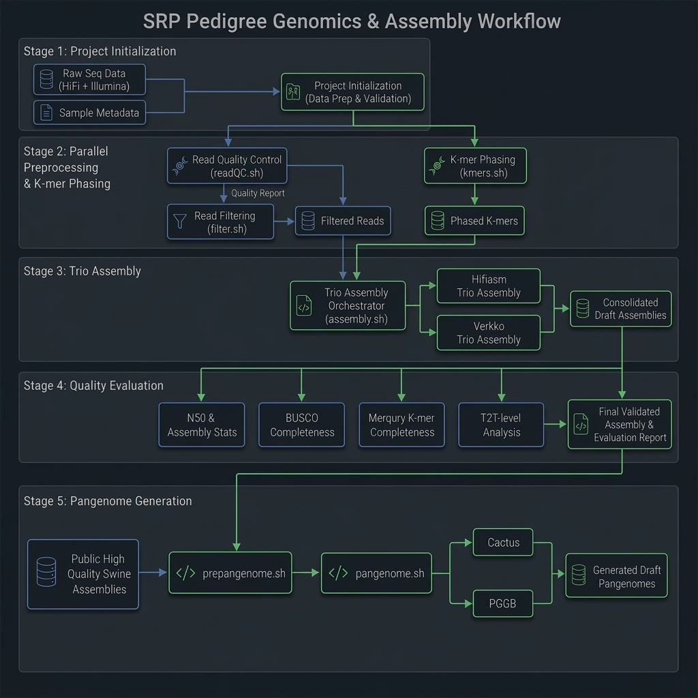

# Bioinformatic pipeline for the SRP workflow

## 🔄 Data Flow & Pipeline Architecture



### 1. initialize.sh
### 2. readQC.sh
### 3. kmers.sh
### 4. filter.sh
### 5. assembly.sh
### 6. assembly-metrics.sh
### 7. prepangenome.sh
### 8. pangenome.sh

---

## 📁 Repository Structure

```text
srp-workflow/
├── env.bashrc                 # Global environment configurations & tool paths
├── initialize.sh              # Project workspace initializer & params.config builder
├── readQC.sh                  # Raw/cleaned data FastQC, SeqKit stats, and MultiQC
├── density_plot.py            # Python script for read length/quality joint density plots
├── filter.sh                  # Trimming & quality filtering (Chopper) for HiFi reads
├── kmers.sh                   # K-mer counting (Meryl & Yak), GenomeScope2, & Merqury hapmers
├── assembly.sh                # Trio assembly orchestrator (HiFiasm & Verkko)
├── launch_hifiasm_trio.sh     # SLURM launcher wrapper for HiFiasm Trio
├── launch_verkko_trio.sh      # SLURM launcher wrapper for Verkko Trio
├── assembly-metrics.sh        # Post-assembly evaluation orchestrator
├── N50.sh                     # QUAST contiguity & N50 analysis wrapper
└── BUSCO.sh                   # Lineage gene completeness wrapper
```
---

# Software Installation

```bash
# Download the repository archive
wget https://github.com/LeeAckersonIV/genome-asm/archive/refs/heads/main.zip

# Unzip only the specific workflow folder
unzip main.zip 'genome-asm-main/srp-workflow/*'
mv ./genome-asm-main/srp-workflow .
rm -rf main.zip genome-asm-main
cd srp-workflow/
export SRP_WORKFLOW="$PWD"

# Build dependency environment
pip install pandas matplotlib seaborn
```
---


# Workflow Execution


**Note:** Adjust the `env.bashrc` to work on your system before running workflow

```bash

# Move to scratch space with plenty of storage space
cd /mnt/gs21/scratch/ackers24/srp-sandbox

# Run initialize.sh
"${SRP_WORKFLOW}/initialize.sh" --projectROOT ${PWD}/SRP1 \
    --illumina.terminal.lib LIB212039 \
    --illumina.maternal.lib LIB212038 \
    --illumina.paternal.lib LIB212041 \
    --illumina.MGS.lib LIB212046 \
    --illumina.MGD.lib LIB212044 \
    --hifi.terminal.lib "LIB212031,LIB215030" \
    --hifi.maternal.lib "LIB212951,LIB215570" &> ${PWD}/SRP1-initialize.log

# Run readQC.sh
sbatch --time=8:00:00 --cpus-per-task=16 --mem=250G \
    --job-name=readQC --output=${PWD}/SRP1/readQC.log \
    --wrap="${SRP_WORKFLOW}/readQC.sh --projectROOT ${PWD}/SRP1 --load.project.params YES"
tail -f readQC.log

# Run kmers.sh
sbatch --time=24:00:00 --cpus-per-task=16 --mem=250G \
    --job-name=kmers --output=${PWD}/SRP1/kmers.log \
    --wrap="${SRP_WORKFLOW}/kmers.sh --projectROOT ${PWD}/SRP1 --load.project.params YES"
tail -f kmers.log

# Run filter.sh
sbatch --time=2-00:00:00 --cpus-per-task=48 --mem=400G \
    --job-name=filter --output=${PWD}/SRP1/filter.log \
    --wrap="${SRP_WORKFLOW}/filter.sh --projectROOT ${PWD}/SRP1 --load.project.params YES"
tail -f filter.log

# Run assembly.sh
${SRP_WORKFLOW}/assembly.sh --projectROOT ${PWD}/SRP1 --load.project.params YES \
    --hifiasm.outdir.name hifiasm_trio --run.verkko FALSE &> ${PWD}/SRP1/assembly.log

# Run assembly-metrics.sh
${SRP_WORKFLOW}/assembly-metrics.sh --projectROOT ${PWD}/SRP1 --load.project.params YES \
    --hifiasm.outdir.name hifiasm_trio --eval.verkko FALSE &> ${PWD}/SRP1/assembly-metrics.log

# Run prepangenome.sh
${SRP_WORKFLOW}/prepangenome.sh --srpDirs "SRP1" --outdir ${PWD}/SRP.v1-pangenome

# Run pangenome.sh
${SRP_WORKFLOW}/pangenome.sh --pangenomeDir ${PWD}/SRP.v1-pangenome --run.cactus TRUE \
    --run.pggb FALSE --run.odgi FALSE &> ${PWD}/pangenome.log


```
---

